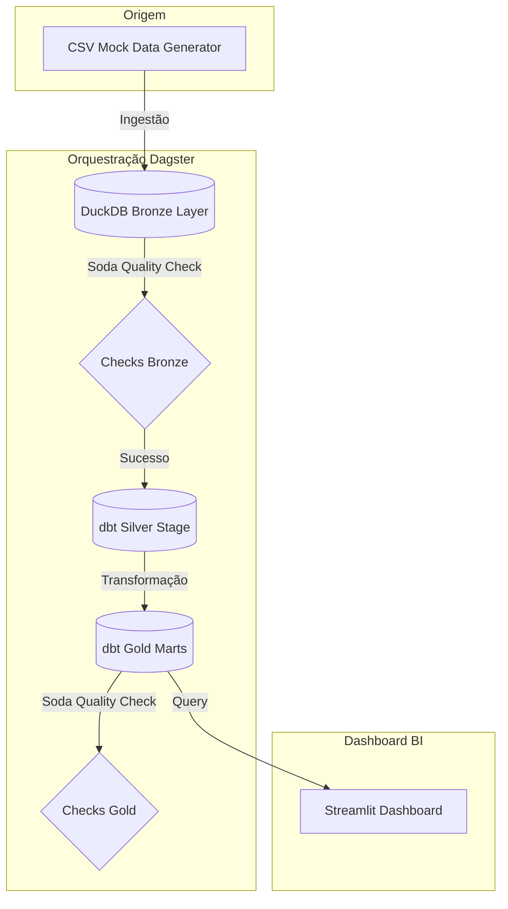

# Batch ELT Pipeline & Data Quality Guardrails

Este projeto implementa uma pipeline de engenharia de dados **end-to-end** de nível sênior, focada em **Engenharia de Analytics e Qualidade de Dados (Data Observability)**. O objetivo é orquestrar cargas de dados em lote (Batch ELT), realizar transformações em modelo dimensional Kimball (SCD Tipo 2) e impor contratos de qualidade rigorosos antes que os dados fiquem disponíveis para visualização.

---

## 🏗️ Arquitetura da Solução



### Componentes & Justificativa de Design:
1.  **Dagster (Asset-based Orchestrator)**: O pipeline é desenhado com base em **Software-Defined Assets (SDAs)**. Em vez de orquestrarmos tarefas (tasks), nós orquestramos ativos de dados (tabelas e arquivos), o que garante muito mais rastreabilidade e integridade de lineage.
2.  **dbt Core & DuckDB**: As transformações analíticas ocorrem diretamente no **DuckDB** (banco analítico colunar local extremamente rápido) utilizando dbt para organizar o código em camadas (Staging -> Marts) e criar modelos dimensionais (fatos e dimensões).
3.  **Soda Core**: Ferramenta de observabilidade e qualidade de dados que aplica testes automatizados (checks) na camada de dados brutos (Bronze) e dados agregados de negócios (Gold), garantindo que dados inválidos ou nulos não cheguem ao Dashboard.
4.  **Streamlit**: Aplicação interativa de BI que consome diretamente o arquivo local do DuckDB para renderizar os KPIs e indicar graficamente o sucesso dos testes de qualidade de dados.

---

## 📁 Estrutura de Diretórios

```text
dagster_pipeline/
│
├── requirements.txt            # Dependências Python (Dagster, dbt-duckdb, soda-core, streamlit)
├── setup.ps1                   # Criação do ambiente virtual .venv e instalação de pacotes
├── dashboard.py                # Visualização em Streamlit dos Marts Gold e métricas Soda
├── README.md                   # Documentação do projeto (esta página)
│
├── data/                       # Diretório gerado contendo o banco analytics.duckdb e CSVs
│
├── soda/
│   ├── configuration.yml       # Credenciais do Soda para conexão com o DuckDB
│   ├── checks_bronze.yml       # Regras de qualidade para os dados brutos (nulos, duplicados)
│   └── checks_gold.yml         # Regras de negócio para as tabelas de fatos e dimensões
│
├── dbt_project/
│   ├── dbt_project.yml         # Configurações do dbt e diretório de banco
│   ├── profiles.yml            # Profile de conexão dbt com DuckDB
│   └── models/
│       ├── staging/            # Camada Silver (Limpeza e Padronização)
│       └── marts/              # Camada Gold (Fatos, Dimensões e Aggs)
│
└── dagster_project/
    ├── assets.py               # Definição dos ativos Dagster (Ingestão, dbt e Soda scan)
    └── definitions.py          # Amarração dos recursos dbt e Jobs
```

---

## 🛠️ Como Executar o Projeto (Passo a Passo)

### Pré-requisitos
*   **Python 3.12.x** (ou superior) instalado.
*   Terminal do **PowerShell** no Windows.

---

### Passo 1: Configurar o Ambiente Virtual e Instalar Pacotes
No terminal PowerShell, na pasta do projeto, execute o script de setup:

```powershell
./setup.ps1
```

O script criará o ambiente virtual `.venv`, atualizará o `pip` e instalará todas as dependências especificadas no `requirements.txt`.

---

### Passo 2: Executar e Compilar o dbt
Antes de iniciar o servidor do Dagster, compile o projeto dbt para gerar o manifesto JSON (`manifest.json`), que é lido pelo Dagster para mapear o lineage:

```powershell
# Ative o ambiente virtual
.venv\Scripts\activate

# Entre na pasta dbt e execute o dbt parse
cd dbt_project
dbt parse --profiles-dir .
cd ..
```

---

### Passo 3: Inicializar a Interface do Dagster
Com o ambiente ativado, execute o dev server do Dagster na porta 3005 (para evitar conflito com o Grafana da primeira pipeline):

```bash
dagster dev -p 3005
```

Acesse a interface web:
👉 **[http://localhost:3005](http://localhost:3005)**

Para rodar o pipeline completo:
1.  Vá em **Assets** no menu superior para visualizar o gráfico de linhagem (`lineage`).
2.  Clique em **Materialize All** no canto superior direito para executar a pipeline completa (gerador de dados -> validação bronze -> dbt build -> validação gold).

---

### Passo 4: Executar o Dashboard Streamlit
Em um novo terminal (com a virtualenv ativada), execute a aplicação Streamlit:

```bash
streamlit run dashboard.py
```

Acesse a interface visual:
👉 **[http://localhost:8501](http://localhost:8501)**

Aqui você verá os gráficos de faturamento líquido, quantidade de pedidos e um validador verde indicando que todas as regras de negócios do **Soda Core** foram aprovadas com sucesso!

---

## 💡 Decisões Técnicas Sênior & Melhores Práticas

### 1. Software-Defined Assets (SDA) no Dagster
Diferente do Airflow, onde as Dags apenas gerenciam a ordem das execuções das tarefas, no Dagster focamos nos **Ativos de Dados**. O Dagster rastreia que a tabela `fct_sales` depende da tabela `stg_sales` e que o scan do Soda depende da tabela física bronze estar populada. Isso simplifica o rastreamento de linhagem e facilita a depuração.

### 2. Contratos de Qualidade de Dados (Data Quality Guardrails)
Implementamos uma barreira (guardrail) de qualidade dupla:
*   **Camada Bronze**: O Soda verifica tabelas vazias, IDs nulos ou duplicados e valores de venda ausentes. Os modelos dbt dependem desse asset. No job completo, só o código de saída zero libera o `dbt build`.
*   **Camada Gold**: Após o dbt processar as agregações, o Soda roda testes lógicos de negócio (faturamento negativo, joins órfãos sem correspondência na dimensão, e status fora do domínio esperado). Se qualquer teste falhar, o pipeline notifica o orquestrador imediatamente.

O [workflow de qualidade](.github/workflows/quality-gate.yml) testa a linhagem, insere uma venda inválida em um DuckDB temporário para comprovar que o dbt não inicia e executa o job completo com dados válidos até a checagem Gold.

### 3. Analytics Engineering sob Modelo Estrela (Star Schema)
Utilizamos o dbt para estruturar os dados analíticos na modelagem Kimball:
*   `stg_sales` e `stg_customers` realizam typecasting, limpeza de strings e normalização de timestamps.
*   `dim_customers` e `fct_sales` dividem os atributos em chaves de dimensão e métricas numéricas.
*   `dm_monthly_sales` gera a agregação pronta para consumo do dashboard de BI.
